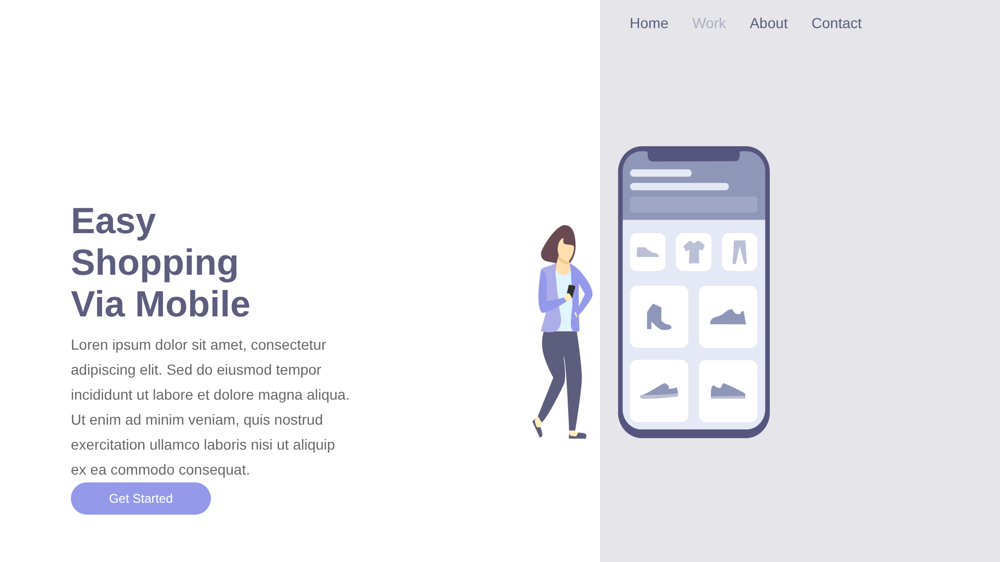
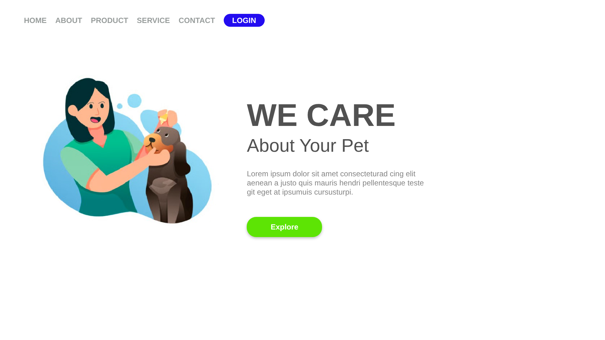

# Projetos de Front-end — HTML e CSS

Landing pages que construí durante a formação de front-end do [DevClub](https://devclub.com.br), reproduzindo layouts e evoluindo de páginas estáticas até um layout responsivo.

🔗 **[Ver todos os projetos online](https://rodrigomarcano.github.io/devclub/)**


## Projetos

| | Projeto | Destaques |
| --- | --- | --- |
|  | **[Easy Shopping — Landing page responsiva](./landing-page-responsiva)**<br>[Ver online](https://rodrigomarcano.github.io/devclub/landing-page-responsiva/) | Flexbox, media queries, layout que se adapta ao celular |
|  | **[Wide Coverage — App de mobilidade](./landing-page-mobilidade)**<br>[Ver online](https://rodrigomarcano.github.io/devclub/landing-page-mobilidade/) | Reprodução de layout a partir de imagem, Flexbox, tipografia |
|  | **[We Care — Pet shop](./landing-page-pet-shop)**<br>[Ver online](https://rodrigomarcano.github.io/devclub/landing-page-pet-shop/) | Estrutura semântica, botões estilizados, fontes externas |

Cada pasta tem seu próprio README explicando o projeto, o que pratiquei e os próximos passos.

## Como executar

Não é preciso instalar nada:

```bash
git clone https://github.com/RodrigoMarcano/devclub.git
```

Depois, abra o `index.html` de qualquer pasta no navegador.

## Autor

**Rodrigo Sena Marçano** — [LinkedIn](https://www.linkedin.com/in/rodrigo-sena-mar%C3%A7ano-8a1b6918/) · [GitHub](https://github.com/RodrigoMarcano)
