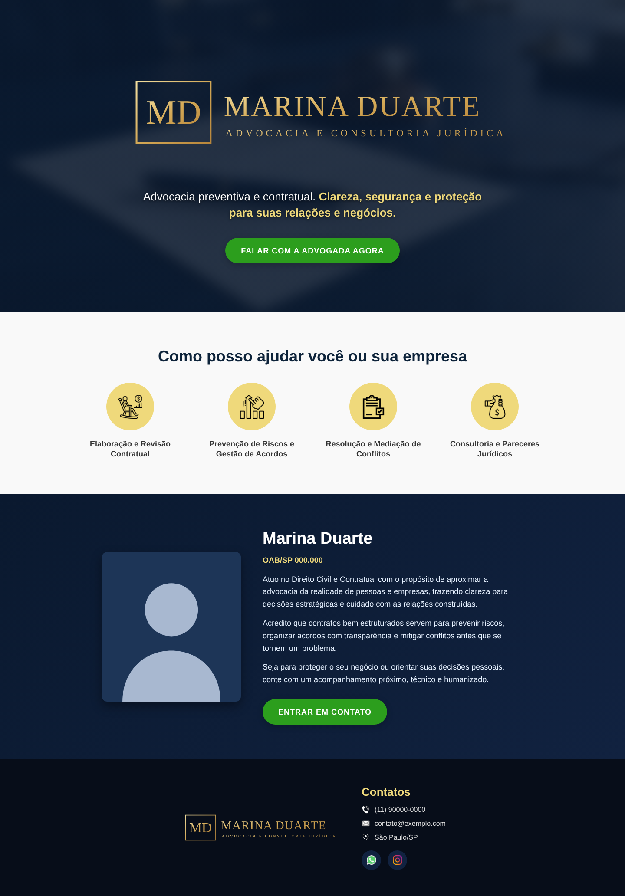

# Landing page de escritório de advocacia

Site institucional de uma página para uma advogada de Direito Civil e Contratual, com apresentação dos serviços, perfil profissional e contato direto.

🔗 **[Ver página online](https://rodrigomarcano.github.io/devclub/landing-page-advocacia/)**

> Nesta versão pública, o nome, a foto, o logo e os contatos foram substituídos por dados fictícios.

| Desktop | Celular |
| --- | --- |
|  |  |

## Sobre o projeto

A página foi pensada para gerar contatos: o botão principal aparece logo no topo, e todas as seções levam o visitante até as formas de falar com a advogada. Ela tem quatro partes:

1. **Cabeçalho:** logo, frase de posicionamento e botão de contato sobre uma imagem de fundo com camada escura
2. **Serviços:** quatro áreas de atuação com ícones e efeito ao passar o mouse
3. **Sobre:** foto, registro na OAB e apresentação profissional
4. **Rodapé:** telefone, e-mail, endereço e redes sociais

## O que pratiquei

- Layout com **Flexbox**, incluindo `flex-wrap` para os cards de serviços se reorganizarem sozinhos
- **Responsividade** com duas media queries (até 950px e até 584px): seções em coluna, textos centralizados e botões em largura total no celular
- Imagem de fundo com camada escura usando `linear-gradient` sobre `url()`
- Gradientes, sombras e transições suaves com `transition` e `transform` nos botões, ícones e redes sociais
- Identidade visual consistente: azul-marinho, dourado e verde para as chamadas de ação
- Favicon e textos alternativos (`alt`) em todas as imagens

## Tecnologias


## Estrutura

```
landing-page-advocacia/
├── index.html
├── styles.css
└── assets/
    ├── logo.svg, favicon.svg, foto-advogada.svg
    ├── fundo-header.jpg
    └── ícones dos serviços e dos contatos
```

## Como executar

Basta abrir o arquivo `index.html` no navegador, ou acessar a [versão online](https://rodrigomarcano.github.io/devclub/landing-page-advocacia/).

## Próximos passos

- Trocar os ícones dos serviços por ícones específicos de cada área jurídica
- Adicionar uma seção de perguntas frequentes
- Incluir metadados de SEO e Open Graph para melhorar o compartilhamento em redes sociais

---

Projeto desenvolvido por [Rodrigo Sena Marçano](https://github.com/RodrigoMarcano).
