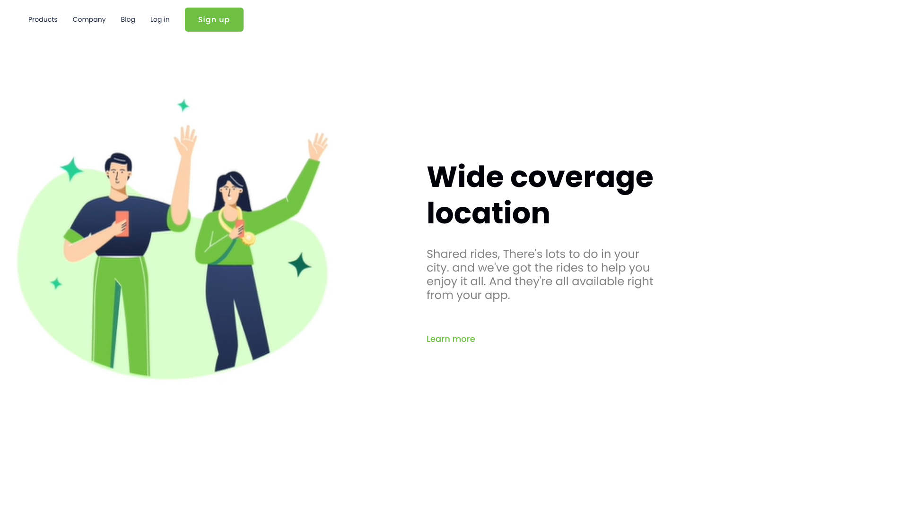

# Wide Coverage — Landing page de app de mobilidade

Página de apresentação de um aplicativo de caronas compartilhadas, feita como desafio de reprodução de layout no curso do DevClub.

🔗 **[Ver página online](https://rodrigomarcano.github.io/devclub/landing-page-mobilidade/)**



## Sobre o projeto

O desafio era receber apenas a imagem do layout final e reproduzi-lo sem código de apoio. A página tem um cabeçalho com links e botão de cadastro, e uma seção principal com ilustração, título, descrição e link de "saiba mais".

## O que pratiquei

- Alinhamento de elementos com **Flexbox** (`display: flex`, `align-items` e `gap`)
- Cabeçalho horizontal com links e botão de destaque
- Tipografia com a fonte Poppins e títulos de peso 800
- Espaçamentos com `padding` e controle de largura do texto com `max-width`
- Botão no estilo link, com fundo transparente

## Tecnologias


## Estrutura

```
landing-page-mobilidade/
├── index.html
├── style.css
└── img/
```

## Como executar

Basta abrir o arquivo `index.html` no navegador, ou acessar a [versão online](https://rodrigomarcano.github.io/devclub/landing-page-mobilidade/).

## Próximos passos

- Adicionar media queries para o layout funcionar no celular
- Usar unidades relativas na ilustração para ela se ajustar a telas menores

---

Projeto desenvolvido por [Rodrigo Sena Marçano](https://github.com/RodrigoMarcano) durante a formação do DevClub.
