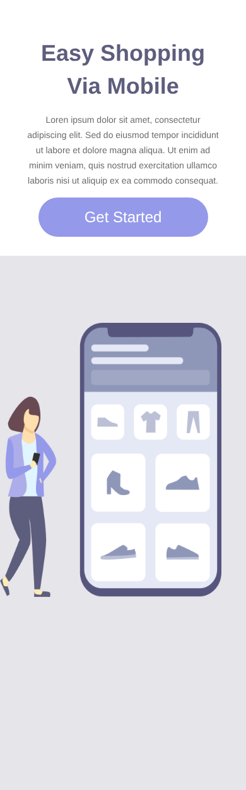

# Easy Shopping — Landing page responsiva

Landing page de um aplicativo de compras fictício que se adapta ao tamanho da tela. No computador, o conteúdo fica dividido em duas colunas; no celular, os blocos se empilham e o texto é centralizado.

🔗 **[Ver página online](https://rodrigomarcano.github.io/devclub/landing-page-responsiva/)** (abra no celular ou diminua a janela do navegador)

| Desktop | Celular |
| --- | --- |
|  |  |

## Sobre o projeto

O desafio foi construir um layout de duas colunas e fazê-lo funcionar bem em telas pequenas, sem criar uma página separada para celular. A adaptação é feita só com CSS.

## O que pratiquei

- Layout em colunas com **Flexbox** (`display: flex` e porcentagens de largura)
- **Media queries** para telas de até 956px e até 330px
- Mudança de direção do layout com `flex-direction: column`
- Ajuste de tamanhos de fonte, margens e alinhamento para leitura no celular
- Imagens fluidas com `max-width`
- Estados de interação nos links com `:hover`, `:active` e `:nth-child`

## Tecnologias


## Estrutura

```
landing-page-responsiva/
├── index.html
├── styles.css
└── assets/
```

## Como executar

Abra o arquivo `index.html` no navegador e redimensione a janela para ver o layout mudar, ou acesse a [versão online](https://rodrigomarcano.github.io/devclub/landing-page-responsiva/).

## Próximos passos

- Criar um menu de navegação próprio para celular (hoje o menu fica oculto em telas pequenas)
- Testar em mais tamanhos de tela intermediários, como tablets

---

Projeto desenvolvido por [Rodrigo Sena Marçano](https://github.com/RodrigoMarcano) durante a formação do DevClub.
